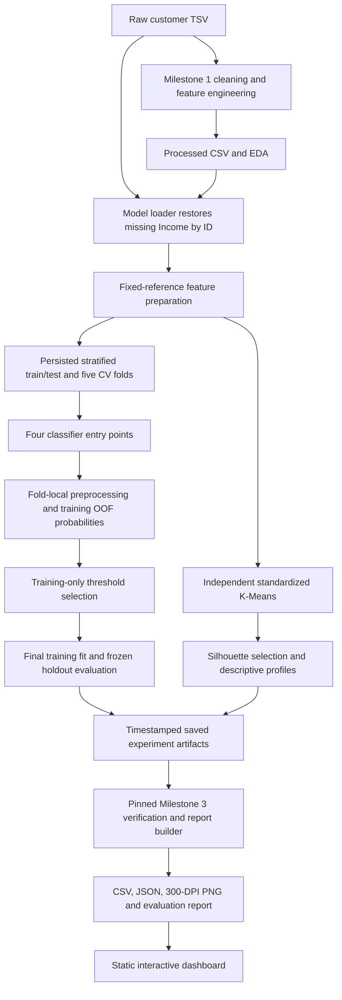

# Project architecture

The repository retains its existing Python modules and buildless HTML/CSS/JavaScript website. Milestone 3 adds verified reporting, tests and documentation rather than a second training pipeline.

K-Means and supervised models are parallel analyses. The diagram's ordering does not imply cluster labels feed classifier training.

| Module / location | Responsibility |
|---|---|
| `data/marketing_campaign.csv` | Immutable raw tab-separated source |
| `docs/milestone1/milestone1_analysis.py` | Original cleaning, four engineered features, EDA and quality exports |
| `experiments/common/data_loader.py` | Validate configurations, resolve paths and restore missing/sentinel Income |
| `common/data_validation.py` | Binary target, unique IDs, finite values and quality audit |
| `common/preprocessing.py` | Feature preparation; unfitted imputation/encoding/scaling pipelines |
| `common/settings.py` | Established shared seeds, split settings, threshold grid and model labels |
| `common/split_manager.py` | Persist shared absolute row indices and CV indices relative to training rows |
| `common/evaluation.py` | Standard metrics, OOF threshold selection and estimator-independent training/evaluation |
| `common/result_saver.py` | Strict JSON, hashes, timestamped output directories and metadata |
| `common/visualization.py` | Headless matplotlib and shared PNG saving |
| `common/artifacts.py` | Completed-run discovery |
| `experiments/{model}/train.py` | Construct one configured estimator and invoke common evaluation |
| `experiments/kmeans/` | Independent clustering, K selection and saved-results explanation |
| `experiments/comparison/` | Compare compatible classifier runs without refitting |
| `experiments/milestone3/sources.json` | Pin exact source runs and reporting destination |
| `experiments/milestone3/build.py` | Verify records, hashes, models, metrics, thresholds and clustering; export reporting bundle |
| `experiments/milestone3/documentation.py` | Generate evidence-based evaluation and AST-derived function reference |
| `experiments/milestone3/validate_workflow.py` | Full original-workflow replay, first-fold permutation and silhouette verification |
| `tests/test_pipeline.py` | Focused invariant and regression checks |
| `docs/index.html`, `dashboard.css`, `dashboard.js` | Browser-only presentation of verified exports |

Paths beginning `common/` in this table are relative to `experiments/`. Exact function signatures, responsibilities, returns and observed call dependencies are in [FUNCTION_REFERENCE.md](FUNCTION_REFERENCE.md).

## Artifact and configuration contracts

Training reads individual JSON configs. `load_config` rejects changes to the established split/seed/target/metric settings. Model parameters remain explicit in those configs. `settings.py` centralizes values used by the shared implementation; duplicated config values serve as a validated record of historical experiment conditions.

Saved models live at `experiments/outputs/<model>/run_*/model.joblib`. Classifier artifacts contain a fitted pipeline, frozen threshold, feature list and reference date. The shared split is keyed by source hashes and evaluation settings. Each new training call creates a unique directory; completed-run discovery ignores retained failed attempts.

Milestone 3 uses pinned source paths rather than implicitly adopting new runs. `provenance.json` hashes original source artifacts; `dashboard_data.json` contains public aggregate results, curves, threshold-development tables and interpretation data. Individual customer IDs/predictions are not copied into the web bundle. The dashboard requires only `docs/`, no Python server-side processing or external CDN.

## Changes and compatibility

- Shared metrics now validate inputs and restore ROC AUC. Confusion matrices always use rows/columns `[0,1]`. For one-class labels ROC AUC is `None`, serialized as JSON null.
- Training threshold selection is a shared function preserving the original F1/precision/proximity policy. It accepts development metric rows only.
- Plot output and completed-run discovery were consolidated; clustering no longer imports the classifier training module just to save plots.
- Comparison recomputes held-out metrics from probabilities and includes ROC AUC. Historical run JSON/CSV files remain untouched.
- Dynamic pathlib imports were replaced with a normal import. No model hyperparameters, feature definitions, original split, thresholds or cluster assignments were changed.
- The empty Milestone 1 notebook is retained as historical scaffolding. The historical audit script is documented and syntax-checked; it is not re-executed because it would overwrite the user's prior audit package.

## Operational boundaries

Raw feature timestamps and offer timing are not established by the repository. Fixed 2014 modeling dates and the 2026 birth-year exclusion convention remain disclosed assumptions. No new hyperparameter search, cluster-fed classifier or causal/ROI estimation is introduced. Further model selection requires training-only validation and fresh confirmation data.
