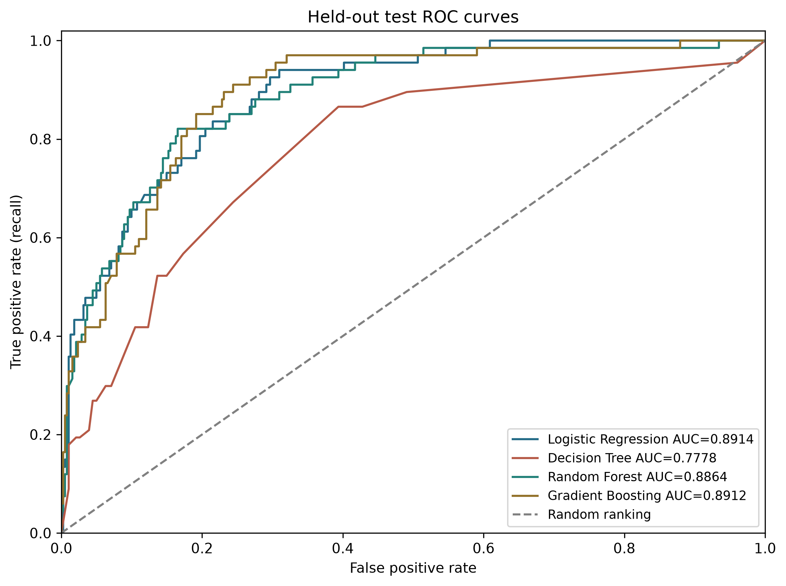
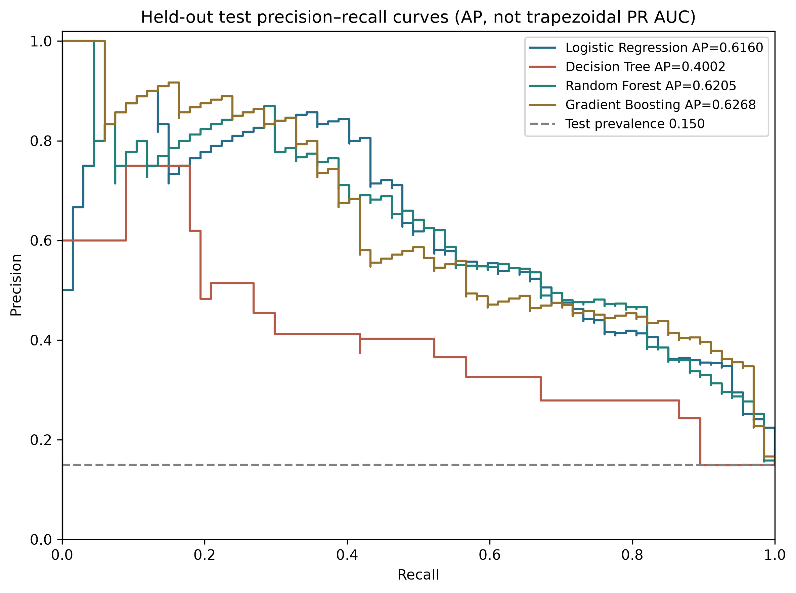
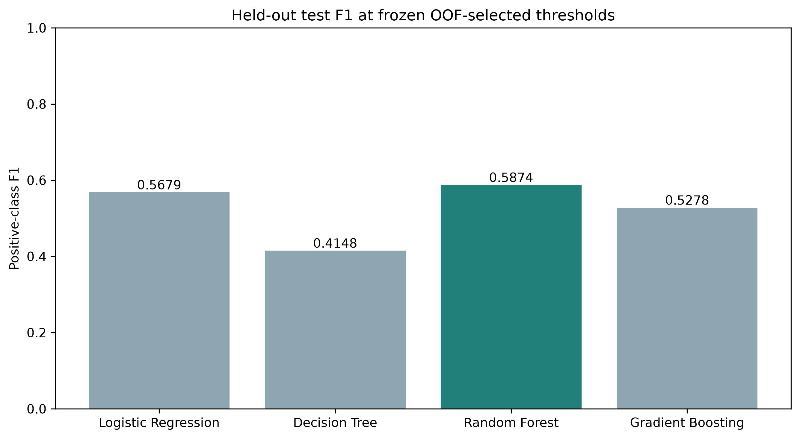

# Model evaluation

Generated from pinned, verified experiment artifacts. No model is tuned or retrained by this report command.

## Data and experimental design

Raw Kaggle Customer Personality Analysis: 2,240 rows, 29 columns. Processed: 2,237 rows, 33 columns. Response=1 means acceptance of the current campaign: 334 responders and 1903 nonresponders (14.93% positive).
Shared stratified 80/20 split: 1789 train, 448 test; 5 shuffled stratified training folds; seed 42. Split ID: `287480a9a9870a43ec7ed3f984324cd844fdec9d9bacdbe40519fb04640b5094`. All four classifiers use identical underlying 28 predictors (39 transformed columns in the final fitted models).

Income missing/sentinel cells are restored from raw IDs before modeling. Median numeric imputation, most-frequent categorical imputation and one-hot encoding are fitted within each training fold. Only Logistic Regression scales numeric predictors. IDs, target and two constants are excluded; birth year/date become age/tenure using 2014-12-31. No feature selection, SMOTE or cluster labels are used.

## Algorithms and exact configured parameters

- **Logistic Regression**: `{'max_iter': 2000, 'class_weight': 'balanced', 'solver': 'lbfgs', 'random_state': 42}`.
- **Decision Tree**: `{'max_depth': 5, 'min_samples_leaf': 10, 'class_weight': 'balanced', 'random_state': 42}`.
- **Random Forest**: `{'n_estimators': 300, 'min_samples_leaf': 3, 'class_weight': 'balanced', 'random_state': 42, 'n_jobs': -1}`.
- **Gradient Boosting**: `{'n_estimators': 200, 'learning_rate': 0.05, 'max_depth': 3, 'random_state': 42}`.

## Evaluation policies and definitions

- **Primary KPI: positive-class F1**, the harmonic mean of precision and recall. It balances missed responders against wasted contacts without being dominated by true negatives. It does not encode financial costs.
- **Accuracy**: (TP+TN)/N, overall correct fraction. Majority-only test accuracy is 381/448 = 85.04%, with positive-class F1=0; accuracy alone is misleading.
- **Precision**: TP/(TP+FP), the fraction of targeted customers who actually respond.
- **Recall**: TP/(TP+FN), the fraction of actual responders reached.
- **ROC AUC**: probability-ranking discrimination over all thresholds, based on false-positive rate versus true-positive rate; random ranking is 0.50.
- **Average Precision (AP)**: sklearn average_precision_score, the sum of precision weighted by increments in recall. This is not trapezoidal PR AUC. The PR no-skill reference is test positive prevalence.
- **Confusion matrix**: rows actual [0,1], columns predicted [0,1], yielding [[TN,FP],[FN,TP]]. FP means contacting a nonresponder; FN means failing to contact an observed responder.
- **CV**: fold metrics at threshold 0.50; mean and sample SD (ddof=1), not confidence intervals.
- **Threshold development**: 17 thresholds, 0.10–0.90 by 0.05, evaluated on pooled training OOF probabilities. Maximize F1, then precision, then proximity to 0.50. This selection reuses OOF labels, so development scores are optimistic.
- **Holdout**: thresholds frozen before test evaluation. Test accuracy/precision/recall/F1 below use selected thresholds. ROC AUC and AP use probabilities and do not change with threshold.

## Verified comparison

| Model | Threshold | CV F1 ± SD (0.50) | Test accuracy | Test precision | Test recall | Test F1 | Test ROC AUC | Test AP |
|---|---:|---:|---:|---:|---:|---:|---:|---:|
| Logistic Regression | 0.60 | 0.5756 ± 0.0226 | 0.8438 | 0.4842 | 0.6866 | 0.5679 | 0.8914 | 0.6160 |
| Decision Tree | 0.75 | 0.4278 ± 0.0410 | 0.8237 | 0.4118 | 0.4179 | 0.4148 | 0.7778 | 0.4002 |
| Random Forest | 0.50 | 0.5628 ± 0.0301 | 0.8683 | 0.5526 | 0.6269 | 0.5874 | 0.8864 | 0.6205 |
| Gradient Boosting | 0.25 | 0.5107 ± 0.0438 | 0.8482 | 0.4935 | 0.5672 | 0.5278 | 0.8912 | 0.6268 |

## Interpretation and campaign decisions

Highest observed test F1: **Random Forest (0.5874)**. Highest selected-threshold precision: **Random Forest (55.26%)**. Highest selected-threshold recall: **Logistic Regression (68.66%)**. The training-CV benchmark remains **Logistic Regression (0.5756)**. The test leaderboard is descriptive, not a new tuning criterion.

- Logistic Regression: contact 95 customers; 46 observed responders reached, 49 nonresponders contacted, 21 responders missed, 332 nonresponders correctly excluded.
- Decision Tree: contact 68 customers; 28 observed responders reached, 40 nonresponders contacted, 39 responders missed, 341 nonresponders correctly excluded.
- Random Forest: contact 76 customers; 42 observed responders reached, 34 nonresponders contacted, 25 responders missed, 347 nonresponders correctly excluded.
- Gradient Boosting: contact 77 customers; 38 observed responders reached, 39 nonresponders contacted, 29 responders missed, 342 nonresponders correctly excluded.

Higher precision suits limited contact capacity; higher recall suits broader outreach when missing a responder is expensive. ROC and PR curves show ranking quality and tradeoffs beyond a single cutoff. PR emphasizes positive-class retrieval under imbalance. AP and ROC AUC can rank models differently from F1. Evaluate future contact-cost, benefit and capacity policies on training/development data, then validate on fresh outcomes.

## Figures and interpretation methods

The dashboard permits model selection and a training-OOF threshold slider. The slider never recomputes or chooses thresholds using holdout labels. Every model has confusion, threshold and importance PNGs in `docs/milestone3/`.

Logistic Regression signed coefficients apply to standardized numeric inputs and unscaled category indicators. Tree importance is normalized impurity reduction and can favor high-cardinality predictors. Saved permutation importance uses the first training validation fold, F1 at 0.50, five repeats and seed 42; it never uses final test records. Correlated totals/components can redistribute importance. None of these methods establishes causality.

## Segmentation verification

Selected K=2; silhouette=0.3038, highest among eligible K=2–8, minimum cluster share 5%. All 16 numeric inputs are median-imputed and standardized on the full customer set. Response and campaign histories are excluded from fitting/selection. Classification does not consume these clusters.

- Cluster 0: 1304 customers, 131 responders, observed rate 10.0460%; mean income 38,257, mean total spending 175.7.
- Cluster 1: 933 customers, 203 responders, observed rate 21.7578%; mean income 70,988, mean total spending 1,206.8.

The task reference of approximately 17.2% for the second cluster does not match complete saved customer assignments. The rates above are recalculated from those assignments; no source records or cluster labels were changed. Income profile means exclude originally missing incomes; clustering uses imputed values.

## Limitations and reproduction

Only 67 positives are in the holdout. No repeated-split uncertainty, paired significance test or clustering stability experiment establishes a reliable winner. Fixed hyperparameters were not searched. Pre-offer availability of all campaign/spending features and the fixed 2014 date require confirmation; Milestone 1 excluded births before 1926 using a 2026 convention. Retained for comparability. Segments are full-data descriptive associations; neither future response nor revenue/ROI improvement has been measured. No operational decision should treat feature effects as causal.

Run `python -m experiments.milestone3.build` from the repository root after installation. It checks source hashes, IDs, common split/folds, saved-model predictions, threshold-grid scores and selection, fitted feature importance, cluster assignments and profiles. Sources are pinned in `experiments/milestone3/sources.json`; hashes are exported to `milestone3/provenance.json`. It recomputes reporting from saved probabilities without refitting. Training commands are in the root README. Further tuning must use training-only validation, nested CV or fresh holdout data.
